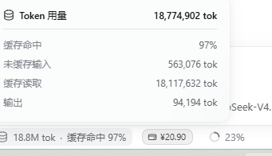

# DSH 余额悬浮条

DeepSeek Harness 的本地 UI 插件：在输入框下方显示 DeepSeek 账户总额（充值余额 + 赠金），每 30 秒自动刷新；悬停显示明细浮窗；点击打开 DeepSeek 开放平台的余额/用量页。



> 图中上方是 DSH 原生的「Token 用量」浮窗，用来对照外观；底部 `¥20.90` 是插件胶囊，金额为充值余额与赠金之和。余额浮窗复用了同一套表面、排版和定位，所以两者看起来是同一种东西。

## 和原版长相接近

余额浮窗不是另起一套 UI，而是直接对齐 DSH 原生「Token 用量 / 会话统计」浮窗的 `stat-dialog`：

- **表面**：`--dsw-specific-menu` 背景、`--dsw-radius-lg` 圆角、`--dsw-elevation-prominent` 阴影、`--dsw-menu-backdrop-filter` 背景模糊；
- **排版**：12px/18px 字号行高、标题 500 字重、`minmax(76px,auto)` 两列 `dl`、0.5px 分隔线、右对齐的等宽数字；
- **定位**：和原生浮窗一样从 `@deepseek-ai/dsh-client-ui-primitives` 引入 `useAnchoredPosition`，`side: 'top'`、8px 间距、12px 视口边距；
- **触发**：胶囊沿用输入框下方 dock 的胶囊形态（11px、圆角、`color-mix` 底色），悬停展开，鼠标移入浮窗不会消失。

区别只有内容：把 Token 桶换成了充值余额、赠金、合计，并在底部多一个「查看余额明细」链接。

## 功能

- 外部胶囊显示 **余额 + 赠金** 的合计（按币种分别求和）。
- 悬停浮窗显示充值余额、赠金、合计，以及「查看余额明细」入口。
- 点击胶囊用系统浏览器打开账号状态中的 `links.usageUrl`。
- 切回 DSH 窗口时立即刷新；30 秒轮询一次。
- 未登录或读取失败时显示占位文案，不会把失败当成 0。

## 安装

1. 把本目录保留在磁盘上（插件通过 `link:` 安装，不能删除）。
2. 在 DSH profile 中安装：

   ```powershell
   dsh plugin --profile desktop add "<本目录绝对路径>"
   ```

   或在 DSH 侧栏「插件 → 添加插件」里选择本地目录。
3. 确认 profile 的 `dsh.profile.bundles` 包含 `@local/dsh-balance-widget`。
4. 如果页面没有自动热载，刷新一次 DSH 页面。

## 卸载

```powershell
dsh plugin --profile desktop remove @local/dsh-balance-widget
```

## 数据来源

- 余额：`ctx.remote.account.getBalance`，与「设置 → 账号」的余额卡片同源。
- 平台链接：`ctx.remote.account.getState` 返回的 `links.usageUrl` / `topUpUrl`。
- 渲染位置：`conversation.composer.dock` 槽位。
- 浮窗样式对齐 `ui-chat` 的 `stat-dialog.module.css`，定位复用 `useAnchoredPosition`。

## 文件

- `client.js`：浏览器半侧（槽位注册、轮询、浮窗、点击跳转）
- `index.js`：Host 半侧（空实现）
- `cordis.patch.yml`：组合包补丁
- `locale/{en,zh}.json`：插件列表元信息
- `icon.svg`：插件图标
- `docs/preview.png`：README 预览图

## 已知限制

- 浏览器端只能轮询，不是服务端推送；余额变化最晚 30 秒反映。
- 点击跳转依赖账号已登录且 Host 返回 Platform 链接。
